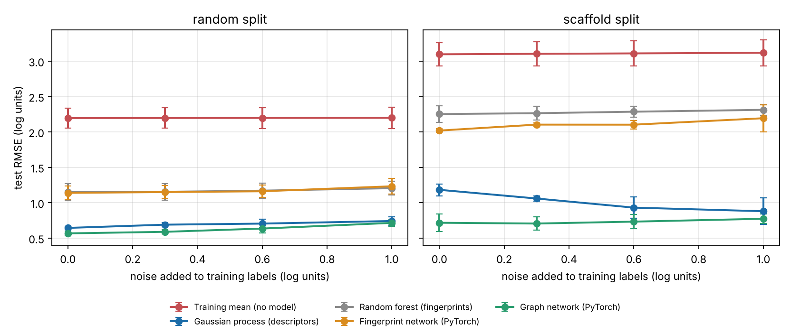
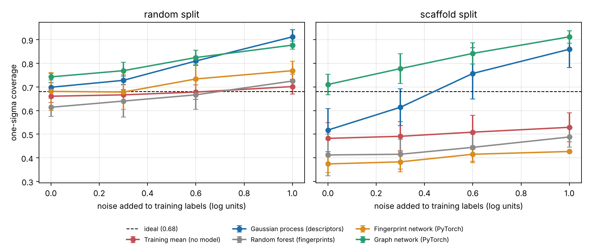

# Solubility Noise Benchmark

**Open-source benchmark of molecular property models under label noise and scaffold shift**

**The repository compares a Gaussian process, a random forest, a fingerprint neural network, and a message-passing graph neural network for aqueous solubility prediction, measuring accuracy and the reliability of predicted uncertainty as training labels are deliberately corrupted with noise.**

[](https://doi.org/10.5281/zenodo.23308184)
[](https://www.python.org/downloads/)
[](https://pytorch.org/)
[](https://opensource.org/licenses/MIT)

---

## DOI and Archival Record

This software is archived on Zenodo to support long-term preservation, reproducibility, and scholarly citation.

**Current Version:** 0.1.2

**DOI (all versions):** https://doi.org/10.5281/zenodo.23308184

**DOI (v0.1.1):** https://doi.org/10.5281/zenodo.23308185

---

## Overview

Experimental property data used to train molecular machine learning models contain measurement error. This repository asks two practical questions:

- How much does predictive accuracy degrade as the error in training labels increases?
- Do the uncertainty estimates reported by each model remain trustworthy under that error?

The benchmark integrates:

- **Four model classes** spanning classical and deep learning approaches
- **Two data splits**: random, and Bemis-Murcko scaffold
- **Controlled label noise** at five levels, from none to as large as the spread of the dataset
- **Uncertainty evaluation** by interval coverage and by rank correlation with error
- **Three random seeds** per condition, with results reported as mean ± standard deviation

All experiments use the ESOL aqueous solubility dataset (1,128 compounds; Delaney, 2004).

---

## Key Findings

1. **Random label noise has a modest effect on accuracy.** On the random split, adding noise with a standard deviation of 1.0 log unit raised the graph network's test RMSE from 0.57 to 0.72. At 2.0 log units, the size of the dataset's full spread, every model still outperformed the training-mean baseline.
2. **Scaffold shift causes more damage than label noise.** On the scaffold split, the fingerprint-based models rose from about 1.15 to above 2.0 RMSE. The graph network held at 0.72.
3. **Models trained on noisy labels become underconfident relative to the truth.** Models that learn a noise term include it in their predictive intervals, which become too wide when evaluated against clean values. One-sigma coverage reached 0.98 at the highest noise level, against a target of 0.68.
4. **Fingerprint models fail silently on unseen scaffolds.** Their intervals covered the true value about 40% of the time, and their predicted uncertainty was negatively correlated with actual error.

---

## Scope and Limitations

This repository is a controlled benchmark on a single public dataset. It is intended for research, education, and methodological comparison.

- One dataset of 1,128 compounds and three random seeds per condition.
- The ESOL values already contain measurement error. "Noise 0" means no added noise, not noise-free labels.
- Added noise is Gaussian and independent of the molecule. Real assay error can be systematic or depend on the property range.
- No hyperparameter search was performed. Each model uses a single fixed configuration.
- Each model is paired with its conventional input representation, so the comparison combines the effect of the model and of the representation.
- Results were generated with one PyTorch CPU thread (`--threads 1`). Different thread counts change the order of floating-point operations and shift the neural network results slightly. In a spot check, the graph network moved from 0.54 to 0.57 RMSE on one condition, within the seed-to-seed spread.

The models are not validated for prospective solubility prediction or for decision-critical use.

---

## Models

| Model | Input representation | Source of uncertainty |
|---|---|---|
| Training mean | None | Standard deviation of training labels |
| Gaussian process (scikit-learn) | 12 RDKit physicochemical descriptors | Posterior variance with a learned white-noise term |
| Random forest (scikit-learn) | Morgan fingerprints (radius 2, 2,048 bits) | Spread of predictions across 300 trees |
| Fingerprint network (PyTorch) | Morgan fingerprints (radius 2, 2,048 bits) | Deep ensemble of 5 networks |
| Graph network (PyTorch) | Atom and bond features | Deep ensemble of 5 networks |

The graph network is a message-passing neural network (Gilmer et al., 2017) implemented in plain PyTorch without a graph library. Each atom receives messages from its bonded neighbours over three rounds, a GRU cell updates the atom state, and sum and mean pooling produce one vector per molecule. Both PyTorch models predict a mean and a variance for each molecule and are trained with a Gaussian negative log-likelihood, following a 10-epoch warm-up on squared error. The ensemble variance combines the average predicted noise with the disagreement between members (Lakshminarayanan et al., 2017).

---

## Experimental Design

**Splits.** Random and scaffold splits, both 80/10/10 for training, validation, and test. In the scaffold split each Bemis-Murcko scaffold is assigned whole to one set, so test molecules contain ring systems absent from training. Scaffold groups larger than half the validation set are assigned to training first.

**Label noise.** Gaussian noise with standard deviation 0, 0.3, 0.6, or 1.0 log10 mol/L is added to training and validation labels on both splits. A level of 2.0 was run on the random split. Validation labels receive noise because, in practice, they are measured in the same way as training labels. Test labels are never altered, so every score is a distance from the reported experimental value.

**Metrics.**

- RMSE and MAE on the clean test set
- One-sigma and 95% interval coverage (targets 0.68 and 0.95)
- Spearman rank correlation between predicted standard deviation and absolute error

---

## Results

### Test RMSE (log10 mol/L, lower is better)



**Random split**

| Model | Noise 0 | Noise 0.3 | Noise 0.6 | Noise 1.0 | Noise 2.0 |
|---|---|---|---|---|---|
| Training mean | 2.20 ± 0.14 | 2.20 ± 0.14 | 2.20 ± 0.15 | 2.20 ± 0.15 | 2.20 ± 0.16 |
| Gaussian process | 0.64 ± 0.02 | 0.69 ± 0.03 | 0.70 ± 0.06 | 0.74 ± 0.06 | 0.84 ± 0.08 |
| Random forest | 1.15 ± 0.12 | 1.15 ± 0.12 | 1.17 ± 0.11 | 1.21 ± 0.10 | 1.31 ± 0.08 |
| Fingerprint network | 1.14 ± 0.10 | 1.15 ± 0.09 | 1.16 ± 0.09 | 1.23 ± 0.11 | 1.52 ± 0.16 |
| Graph network | 0.57 ± 0.03 | 0.59 ± 0.03 | 0.63 ± 0.06 | 0.72 ± 0.05 | 0.87 ± 0.06 |

**Scaffold split**

| Model | Noise 0 | Noise 0.3 | Noise 0.6 | Noise 1.0 |
|---|---|---|---|---|
| Training mean | 3.10 ± 0.16 | 3.10 ± 0.17 | 3.11 ± 0.18 | 3.12 ± 0.18 |
| Gaussian process | 1.18 ± 0.08 | 1.06 ± 0.04 | 0.93 ± 0.15 | 0.88 ± 0.19 |
| Random forest | 2.25 ± 0.12 | 2.26 ± 0.10 | 2.29 ± 0.08 | 2.31 ± 0.07 |
| Fingerprint network | 2.02 ± 0.03 | 2.10 ± 0.03 | 2.10 ± 0.06 | 2.19 ± 0.19 |
| Graph network | 0.72 ± 0.13 | 0.71 ± 0.09 | 0.73 ± 0.10 | 0.77 ± 0.07 |

At a noise level of 2.0 on the random split, the added error equals the spread of the dataset, yet all four models still outperform the training mean. The Gaussian process (0.84 ± 0.08) and the graph network (0.87 ± 0.06) overlap within their seed-to-seed spread and cannot be separated at this level. The fingerprint network shows the largest loss, from 1.23 at noise 1.0 to 1.52.

The scaffold split is difficult on this dataset for an additional reason. The two largest scaffold groups (acyclic molecules and molecules whose only ring is a single benzene) are assigned to training, leaving the test set with larger, less soluble multi-ring compounds. Across the three seeds the mean training label was about -2.9 log units and the mean test label ranged from -4.3 to -5.1. The models are therefore required to extrapolate, which the fingerprint-based models do poorly.

### Reliability of Predicted Uncertainty

One-sigma coverage is the fraction of test molecules whose experimental value lies within the predicted one-sigma interval. A well-calibrated model scores about 0.68. Lower values indicate overconfidence.



| Model | Random, noise 0 | Random, noise 1.0 | Random, noise 2.0 | Scaffold, noise 0 | Scaffold, noise 1.0 |
|---|---|---|---|---|---|
| Gaussian process | 0.70 ± 0.02 | 0.91 ± 0.03 | 0.98 ± 0.02 | 0.52 ± 0.09 | 0.86 ± 0.08 |
| Random forest | 0.61 ± 0.04 | 0.73 ± 0.03 | 0.81 ± 0.03 | 0.41 ± 0.09 | 0.49 ± 0.04 |
| Fingerprint network | 0.68 ± 0.08 | 0.77 ± 0.04 | 0.75 ± 0.08 | 0.37 ± 0.04 | 0.43 ± 0.01 |
| Graph network | 0.74 ± 0.01 | 0.88 ± 0.02 | 0.98 ± 0.02 | 0.71 ± 0.04 | 0.91 ± 0.03 |

On the random split with clean labels, all four models lie close to the 0.68 target. As noise increases, coverage for the Gaussian process and the graph network climbs to 0.98, meaning nearly every experimental value falls inside an interval designed to contain about 68% of them. Both models absorb the label noise into their uncertainty, so their intervals become much wider than their actual error against clean values. A user ranking compounds by these intervals would overestimate how wrong the predictions are.

On the scaffold split, the random forest and the fingerprint network cover the experimental value only about 40% of the time, and the rank correlation between their predicted uncertainty and actual error is about -0.3 (see `results/summary.md`). These models are most confident on the molecules they predict worst. The graph network remains close to target, at 0.71, with clean labels.

### Gaussian Process Diagnostic

On the scaffold split, the Gaussian process improved as labels became noisier, from 1.18 RMSE with clean labels to 0.88 at noise 1.0. The diagnostic script (`scripts/gp_diagnostic.py`, output in `results/gp_diagnostic.csv`) compares the fitted kernels:

| Labels | Median length scale | Learned noise term (standardized units) |
|---|---|---|
| Clean | 2.0 to 2.4 | about 0.04 |
| Noise 1.0 | 5.8 to 28.7 | about 0.27 |

Noisy labels led the model to a smoother function, which extrapolated better to unseen scaffolds. The model fitted to clean labels captured fine structure that did not transfer. This observation rests on three seeds and one dataset and should be tested further before it is generalized.

---

## Installation

### Requirements

- Python 3.10 or higher
- PyTorch 2.x (the CPU build is sufficient)
- RDKit, scikit-learn, NumPy, pandas, SciPy, Matplotlib, pytest

### Setup

```bash
# Clone the repository
git clone https://github.com/Oluwaseun-O-Ajayi/solubility-noise-benchmark.git
cd solubility-noise-benchmark

# Install the CPU build of PyTorch, then the remaining dependencies
pip install torch --index-url https://download.pytorch.org/whl/cpu
pip install -r requirements.txt

# Run the test suite
pytest -q
```

On Windows, a dedicated environment avoids conflicts between PyTorch and existing packages:

```bash
conda create -n solnoise python=3.11 -y
conda activate solnoise
```

---

## Usage

### Full Experimental Grid

```bash
python scripts/run_experiments.py --threads 1
python scripts/summarize.py
python scripts/gp_diagnostic.py
```

The full grid contains 24 conditions (2 splits, 4 noise levels, 3 seeds). Each condition takes about 4 minutes on a 2-core CPU. Seeds can be run as separate processes.

### Single Condition

```bash
python scripts/run_experiments.py --seeds 0 --splits random --sigmas 0 --out results/quick.csv
```

### Additional Noise Level

```bash
python scripts/run_experiments.py --seeds 0 1 2 --splits random --sigmas 2.0 --threads 1 --out results/noise_2.csv
```

### Command-Line Options

| Option | Default | Description |
|---|---|---|
| `--seeds` | `0 1 2` | Random seeds |
| `--splits` | `random scaffold` | Split types |
| `--sigmas` | `0.0 0.3 0.6 1.0` | Label noise levels (log10 mol/L) |
| `--members` | `5` | Networks per deep ensemble |
| `--threads` | `0` (PyTorch default) | CPU threads for PyTorch |
| `--out` | `results/results.csv` | Output file |

---

## Project Structure

```
solubility-noise-benchmark/
├── solnoise/
│   ├── data.py          # ESOL loading and SMILES canonicalization
│   ├── features.py      # Descriptors, Morgan fingerprints, molecular graphs
│   ├── splits.py        # Random and scaffold splits
│   ├── noise.py         # Gaussian label noise
│   ├── baselines.py     # Gaussian process and random forest
│   ├── networks.py      # Fingerprint network, graph network, Gaussian likelihood
│   ├── training.py      # Training loop, early stopping, deep ensembles
│   ├── metrics.py       # RMSE, MAE, coverage, uncertainty-error correlation
│   └── experiment.py    # One condition: split, noise level, seed, all models
├── scripts/
│   ├── run_experiments.py
│   ├── summarize.py
│   └── gp_diagnostic.py
├── tests/               # 21 unit tests
├── data/esol.csv
├── results/             # Raw results, summary tables, diagnostic output
└── figures/
```

---

## Testing

The test suite contains 21 tests and runs in about 15 seconds. It covers featurization, split integrity (no scaffold shared between sets), noise reproducibility, metric correctness against Gaussian theory, network output shapes, and training behaviour. It also verifies that the graph network returns the same prediction when the atoms of a molecule are listed in a different order, and the same prediction for a molecule alone or within a batch.

```bash
pytest -q
```

---

## Output Files

- `results/results.csv`: one row per model per condition, with all metrics
- `results/noise_2.csv`: the noise 2.0 condition on the random split
- `results/summary.md`: mean ± standard deviation tables
- `results/gp_diagnostic.csv`: fitted Gaussian process kernel parameters
- `figures/rmse_vs_noise.png`, `figures/coverage_vs_noise.png`, `figures/rank_corr_vs_noise.png`

---

## Research Applications

- **Drug discovery:** assessing how assay error in ADME training data propagates to property predictions
- **Model selection:** comparing representations and model classes under realistic distribution shift
- **Uncertainty quantification:** testing whether predictive intervals remain reliable when labels are noisy
- **Teaching:** a compact, tested reference implementation of a message-passing network and deep ensembles

---

## Future Work

- Extension to a second property, such as lipophilicity (about 4,200 compounds)
- Systematic error models, such as an offset between laboratories
- Recalibration of predictive intervals under label noise
- Evaluation of every model on every input representation

---

## Data Source

`data/esol.csv` is the processed ESOL file distributed with DeepChem and MoleculeNet.

---

## References

- Delaney, J. S. (2004). ESOL: Estimating aqueous solubility directly from molecular structure. *Journal of Chemical Information and Computer Sciences*, 44(3), 1000-1005.
- Wu, Z., et al. (2018). MoleculeNet: a benchmark for molecular machine learning. *Chemical Science*, 9, 513-530.
- Bemis, G. W., & Murcko, M. A. (1996). The properties of known drugs. 1. Molecular frameworks. *Journal of Medicinal Chemistry*, 39(15), 2887-2893.
- Rogers, D., & Hahn, M. (2010). Extended-connectivity fingerprints. *Journal of Chemical Information and Modeling*, 50(5), 742-754.
- Gilmer, J., et al. (2017). Neural message passing for quantum chemistry. *Proceedings of the 34th International Conference on Machine Learning*.
- Lakshminarayanan, B., Pritzel, A., & Blundell, C. (2017). Simple and scalable predictive uncertainty estimation using deep ensembles. *Advances in Neural Information Processing Systems 30*.

---

## License

MIT License. See `LICENSE`.

---

## Citation

If you use this benchmark in research or teaching, please cite:

```text
Ajayi, O. O. (2026).

Solubility Noise Benchmark: Molecular property models under label noise and scaffold shift
(Version 0.1.2) [Computer software].

Zenodo.

DOI: 10.5281/zenodo.23308184
```

### BibTeX

```bibtex
@software{solubility_noise_benchmark_2026,
  author = {Ajayi, Oluwaseun O.},
  title = {Solubility Noise Benchmark: Molecular property models under label noise and scaffold shift},
  year = {2026},
  version = {0.1.2},
  publisher = {Zenodo},
  doi = {10.5281/zenodo.23308184},
  url = {https://doi.org/10.5281/zenodo.23308184}
}
```

---

## Author

**Oluwaseun O. Ajayi**
Department of Chemistry, University of Georgia
ORCID: [0000-0003-0040-7217](https://orcid.org/0000-0003-0040-7217)
